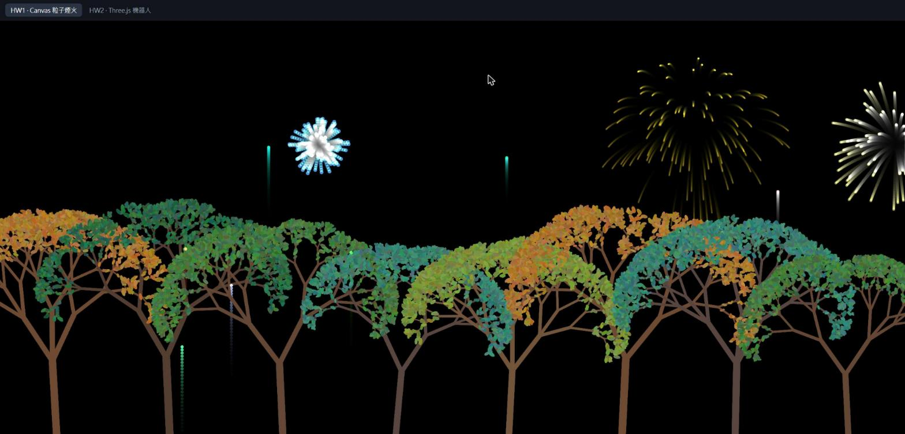
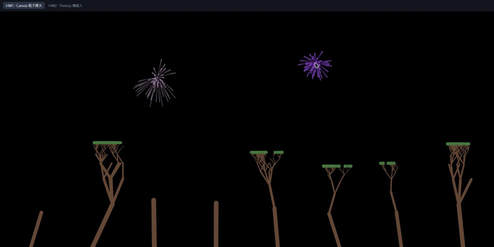
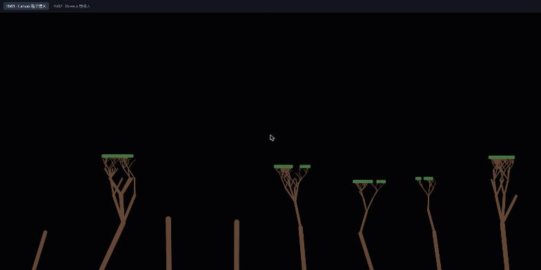
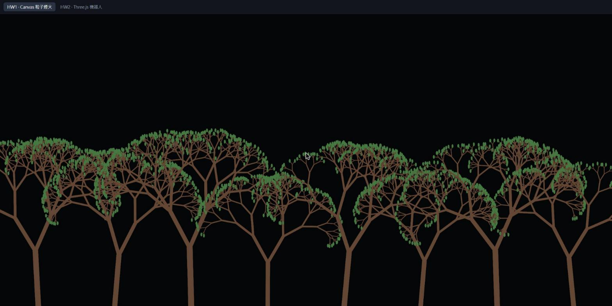
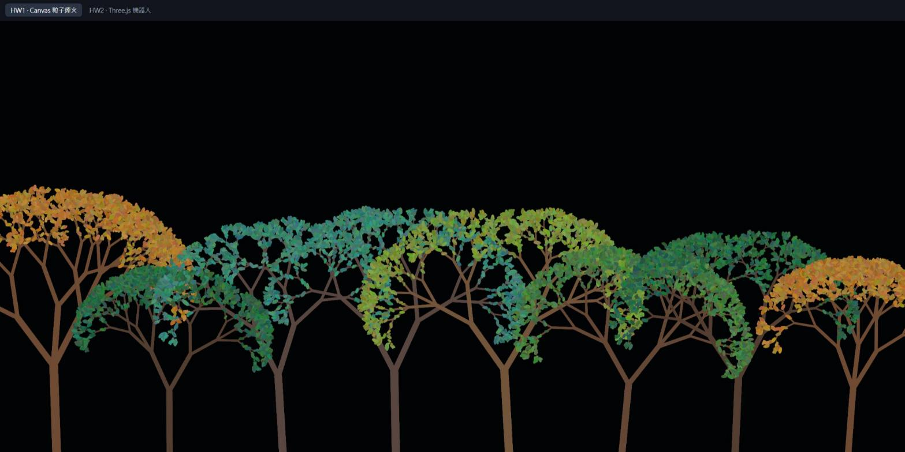
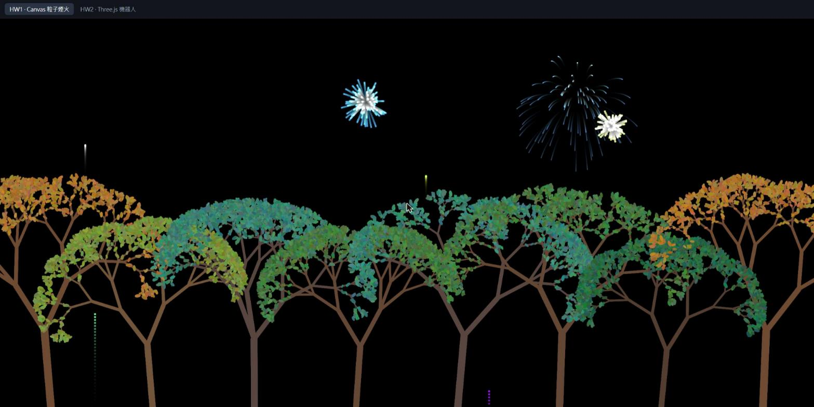

# HW1 報告：Canvas 煙火 × 遞迴森林

> Web Graphics Homework 1 · React + TypeScript + Canvas 2D
> 簡報版：https://www.figma.com/slides/Ubw8z27r9bxaWbBMpj2Bxi



## 1. 執行方式

```bash
npm install
npm run dev
```

開啟 `http://localhost:5173/#/hw1`。

- 畫面會**自動**從地面發射煙火。
- **點擊**畫面任一處：從點擊位置正下方的地面發射一顆煙火，飛到點擊的高度爆炸。
- 改變視窗大小時，會重新長出一片新的森林。

## 2. 作業要求對照

| 作業要求 | 實作方式 |
| --- | --- |
| 以 canvas 繪製粒子效果 | `Particle` 類別，圓形粒子，每次爆炸產生 100 顆 |
| 粒子路徑受重力或其他力影響 | 重力 `vy += g`、空氣阻力 `v *= 0.97`、位置 `p += v` |
| 以森林作為背景 | 遞迴樹 `Tree` × 8 棵，參考 lec03 |
| 註明參考來源 | 見本文第 7 節 |

## 3. 程式架構

```
src/hw1/
├── Hw1Fireworks.tsx   React 元件：動畫迴圈、自動/點擊發射、殘影
├── particle.ts        爆炸後的單一粒子
├── firework.ts        從地面往上飛的煙火彈
├── forest.ts          長出整片森林、畫到離屏 canvas
├── tree.ts            遞迴樹枝
└── leaf.ts            葉子與隨機配色
```

每一幀的流程：

1. 蓋一層 `rgba(0, 0, 0, 0.1)` 半透明黑色，讓舊的畫面慢慢變暗，形成殘影。
2. 用 `drawImage` 把森林貼回來。森林事先畫在離屏 canvas 上，只有視窗大小改變時才重畫。
3. 依機率自動發射煙火。
4. 切換成 `lighter` 混合模式，更新並畫出煙火彈與粒子。
5. `requestAnimationFrame` 預約下一幀。

## 4. 演化過程

### v1：點一下就爆炸，加上第一版的樹



**做了什麼**

- `Particle`：隨機角度，用 `cos` / `sin` 拆成 `vx`、`vy`；重力讓 `vy` 每幀增加；`alpha` 每幀遞減。
- 點擊畫面時，在點擊位置產生 60 顆同色粒子。
- 第一版遞迴樹：每根樹枝隨機長出 0～4 根子枝，終點寫成 `endY = y - base`。

**發現的問題**

1. 大約 20% 的樹只有樹幹：第一層抽到 0 根子枝就停了。
2. 所有樹的頂端一樣高，看起來像平台。
3. 粒子消失前會「閃一下」。
4. 天空留下淡淡的灰色殘影。

### Bug：粒子消失前為什麼會閃一下？

`alpha` 從 1 開始每幀減 0.015，第 67 幀會變成 −0.005。canvas 規定 `globalAlpha` 只接受 0～1，**超出範圍的值會被直接忽略**，維持上一次的 1。原本的順序是「先更新、再畫、最後才檢查要不要刪除」，所以粒子在最後一幀以完全不透明的狀態被畫出來。

```ts
// 修正前：先畫再檢查
p.update()
p.draw(ctx)            // alpha = -0.005，globalAlpha 被忽略 → 以 1 畫出
if (p.alpha <= 0) particles.splice(i, 1)

// 修正後：先檢查再畫
p.update()
if (p.alpha <= 0) {
  particles.splice(i, 1)
  continue
}
p.draw(ctx)
```

迴圈從陣列後面往前跑，`splice` 刪掉元素時，前面還沒處理的 index 不會被打亂。

### v2：用角度長樹枝，樹冠變圓

| v1 | v2 |
| --- | --- |
|  |  |

**平頂的原因**：每根樹枝不管往旁邊偏多少，往上都走滿 `base` 這麼長。從樹根走到任何一個枝端，總高度都是 `base + 0.6·base + 0.6²·base + …`，所以所有枝端一樣高。

**修正**：把樹枝方向存成角度，用三角函數拆成水平、垂直兩個分量。canvas 的 y 軸往下為正，所以往上要用減的：

```ts
this.endX = x + Math.sin(angle) * length
this.endY = y - Math.cos(angle) * length
```

角度為 0 時就等於原本的 `y - length`；樹枝越斜，往上的分量越少，樹冠自然變成圓弧形。

同時調整分岔規則：

- 每次分岔大多 2 根，30% 機率 3 根，不會再出現 0 根。
- 子枝角度 = 父枝角度 ± 0.5 弧度（約 28°），再加上一點隨機擾動。
- 終止條件改成遞迴深度 7 層，每層長度乘以 0.7，樹的大小比較一致。

### v3：葉子長滿細枝，每棵樹不同顏色



- **沿樹枝長葉子**：第 4 層以後的每根樹枝都長 3 片葉子，位置用線性內插決定：`起點 + (終點 − 起點) × t`，其中 `t` 隨機落在 0.3～1。
- **葉子方向**：葉子用 `ellipse` 畫，旋轉角度 = 樹枝角度往左或往右偏 0.4～0.9 弧度；半徑在 2～4 之間隨機。
- **配色**：5 組樹皮加葉子的基準色（綠、深綠、黃綠、藍綠、秋天橘黃），每棵樹隨機挑一組。每片葉子再以基準色為中心，rgb 各通道 ±25 隨機變化。
- **先畫樹枝、再畫葉子**：避免葉子被後面畫的樹枝蓋住。
- **離屏 canvas**：整片森林大約有 1 萬片葉子，不適合每一幀重畫。改成視窗大小改變時畫一次到離屏 canvas，之後每一幀只用 `drawImage` 貼上。

### v4：煙火從地面升空，到最高點才爆炸



**煙火彈（`Firework`）**

希望煙火剛好在高度 H 停下並爆炸，由等加速度運動 `v² = 2gH` 反推初速：

```ts
const height = Math.max(0, y - targetY)
this.vy = -Math.sqrt(2 * this.gravity * height)   // 往上為負
```

之後每一幀 `vy += gravity`，當 `vy >= 0`，也就是到達最高點時，就換成一團粒子。

- 自動發射：每幀有 3% 機率在隨機位置發射，爆炸高度落在畫面上方 15%～45%。
- 點擊發射：`targetY` 設成點擊的 y 座標。

**讓爆炸更好看**

| 改動 | 效果 |
| --- | --- |
| 空氣阻力 `v *= 0.97`（參考 lec02 p.33 的 friction） | 爆開後迅速減速、在空中懸停，再被重力拉下，形成垂落的弧線 |
| 亮色：隨機 rgb 後等比例放大，讓最大的通道等於 255 | 保留色相，但不會再抽到暗色 |
| `globalCompositeOperation = 'lighter'` | 顏色相加，粒子重疊的地方更亮，像在發光 |
| 每次爆炸 60 → 100 顆 | 更飽滿 |

### v5：調整參數，讓爆炸更大


| 參數 | 之前 | 現在 |
| --- | --- | --- |
| 粒子半徑 `radius` | 3 | 5 |
| 粒子初速 `speed` | 1～6 | 2～8 |
| 煙火彈半徑 | 2.5 | 3.5 |

爆炸直徑大約變成原本的 2 倍。

## 5. 用到的物理與數學

| 公式 | 用途 | 出處 |
| --- | --- | --- |
| `v += a`、`p += v` | 重力：每幀更新速度與位置 | lec02 p.39 |
| `v *= 0.97` | 空氣阻力：乘法遞減，一開始減得多，之後越來越少 | lec02 p.33 |
| `vx = cos θ · s`、`vy = sin θ · s` | 把「方向 + 速度」拆成 x、y；粒子與樹枝方向都用到 | — |
| `v = √(2gH)` | 煙火彈剛好在高度 H 停下所需的初速 | — |
| `a + (b − a) · t` | 線性內插：沿樹枝放葉子 | 講義未涵蓋，自行補充 |
| 亮度 × 0.9ⁿ | 殘影：每幀蓋 10% 黑，舊像素剩 90% | lec02 p.37 |
| `alpha −= 0.012` | 減法遞減：約 83 幀後歸零並刪除粒子 | — |

**減法與乘法遞減的差別**：`alpha` 用減法，保證一定會歸零，粒子才能被刪除；速度和半徑用乘法，模擬阻力與衰減，越後面變化越慢，看起來比較自然。

## 6. 已知限制

- **殘影長度與螢幕刷新率有關**：每幀蓋一次黑，在 144Hz 螢幕上殘影會比 60Hz 短。若要完全一致，需要依每幀經過的時間（delta time）調整。
- **灰色殘留**：顏色是 0～255 的整數，很暗的像素乘以 0.9 後四捨五入會回到原值，天空可能留下極淡的痕跡。
- **爆炸中心偏白**：`lighter` 會把重疊的顏色一直相加，粒子密集處會變白。
- **改變視窗大小會重新長出森林**：森林依視窗尺寸生成，尺寸改變時才重畫。

## 7. 參考來源與分工

### 課程講義

| 講義 | 內容 | 用在哪裡 |
| --- | --- | --- |
| lec02 p.8 | `addEventListener` | 點擊發射 |
| lec02 p.30 | 煙火範例出處：Coding Fireworks | 整體架構 |
| lec02 p.33–34 | `Particle` 類別 | 粒子結構、friction |
| lec02 p.35–36 | `Firework` 類別 | 一次爆炸產生多顆粒子 |
| lec02 p.37–38 | `animate` 迴圈 | `rgba(0,0,0,0.1)` 殘影、`requestAnimationFrame`、隨機 rgb、`splice` 移除 |
| lec02 p.39 | Add gravity force | 重力 `v(n+1) = v(n) + a·t` |
| lec03 p.13–17 | Recursive Tree、make forest | 遞迴樹、多棵樹、隨機樹高與顏色 |

### 分工

**自己撰寫**

- `Particle` 類別（第一版）
- `Tree` / `Leaf` 遞迴樹（第一版）

**Claude Code 協助**

- 「閃一下」bug 的診斷與修正（先檢查再畫）
- 角度分岔、沿樹枝長葉子、配色、離屏 canvas
- `Firework` 升空、空氣阻力、亮色、`lighter` 疊加
- React 外殼：`useRef`、`useEffect`、`ResizeObserver`、`devicePixelRatio`
