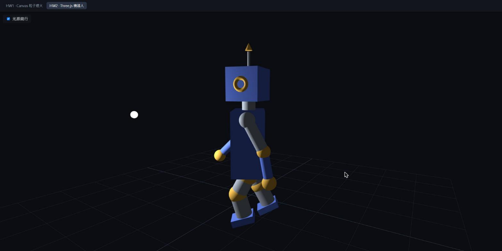
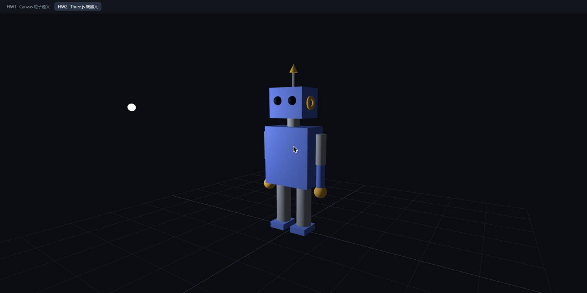
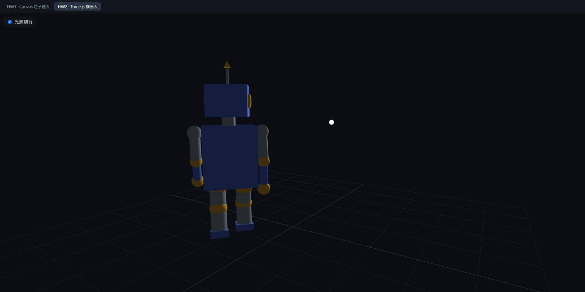

# HW2 報告：Three.js 機器人

> Web Graphics Homework 2 · React + TypeScript + three.js
> 簡報版：https://www.figma.com/slides/08X8OQasaccggJmXw0c5cP



## 1. 執行方式

```bash
npm install
npm run dev
```

開啟 `http://localhost:5173/#/hw2`。

- 機器人會沿著圓圈散步，點光源繞著場景旋轉。
- 滑鼠拖曳可以旋轉視角，滾輪可以縮放（`OrbitControls`）。
- 左上角的「光源繞行」勾選框可以切換光源繞行或固定。

## 2. 作業要求對照

| 作業要求 | 實作方式 |
| --- | --- |
| 使用 Box、Cone、Sphere、Cylinder、Torus 等 Geometry 組成三維機器人 | 五種全部用到，見第 4 節 |
| 不讀入外部模型檔 | 所有部件都是程式碼建立的 `Mesh`，沒有 .obj / .gltf |
| 點光源繞著機器人旋轉 | `PointLight` 以 `cos` / `sin` 在 xz 平面繞半徑 3 的圓 |
| 加分：以移動、旋轉、縮放製作機器人動畫 | 繞圈散步、手腳擺動、眨眼與天線脈動，見第 7 節 |

## 3. 程式架構

```
src/hw2/
├── Hw2Robot.tsx   React 元件：renderer、場景、相機、OrbitControls、動畫迴圈、光源開關
├── robot.ts       機器人結構（class robot extends THREE.Group）與 update(t) 動畫
└── light.ts       繞行點光源（class light extends THREE.PointLight）與位置標示小球
```

每一幀的流程：

1. `clock.getElapsedTime()` 取得經過的秒數 `t`。
2. `light.update(t, orbit)`：更新光源位置。
3. `robot.update(t)`：更新機器人的位置與各關節角度。
4. `renderer.render(scene, camera)`：畫出畫面。

## 4. 五種幾何體



*第一版組裝，光源固定，尚未加上關節球與膝蓋。*

| Geometry | 用在 |
| --- | --- |
| `BoxGeometry` | 頭、身體、腳掌 |
| `SphereGeometry` | 眼睛、手、關節球 |
| `CylinderGeometry` | 脖子、天線桿、上臂、前臂、大腿、小腿 |
| `ConeGeometry` | 天線頂端 |
| `TorusGeometry` | 耳朵（`rotation.y = π/2`，讓圓環朝向側面） |

材質使用 `MeshPhongMaterial`，分成藍、鋼灰、深灰、琥珀四種顏色。Phong 材質會受光、有反光，點光源繞行時才看得出明暗變化；若使用 `MeshBasicMaterial`，光源不會有任何效果。

## 5. 階層與關節

```
robot (Group)
└── body (Box)
    ├── neck, head (Box)
    │   └── 眼睛 ×2、耳朵 ×2、天線桿、天線頂
    ├── shoulder ×2 (Group 關節 + 關節球)
    │   ├── upperArm (Cylinder)
    │   └── elbow (Group 關節 + 關節球)
    │       └── forearm (Cylinder)、hand (Sphere)
    └── hip ×2 (Group 關節 + 關節球)
        ├── thigh (Cylinder)
        └── knee (Group 關節 + 關節球)
            └── shin (Cylinder)、foot (Box)
```

- **關節是空的 `Group`**：Mesh 會繞自己的中心旋轉，直接轉手臂會像螺旋槳。把 Group 放在肩膀位置，手臂 Mesh 往下移半個長度，轉動 Group 時手臂就會繞著肩膀轉。這對應講義 lec06 p.45 的 RightShoulder → RightArm → RightJointArm → RightForeArm 節點設計。
- **子物件自動跟著動**：`add()` 建立父子關係，子物件的 `position` 是相對於父物件的。three.js 每一幀會把父、子的變換相乘，算出每個部件在世界座標中的位置，所以動畫只需要改關節的角度。
- **關節球**：手肘彎曲時，上臂與前臂兩個圓柱的端面會錯開，露出縫隙。在每個關節 Group 的原點放一顆比手臂稍粗的球，從任何角度看都能蓋住接縫。
- **膝蓋**：腿拆成大腿與小腿兩節，中間加上膝關節，走路時小腿可以往後彎。

## 6. 尺寸與位置

three.js 的形狀都以**中心**為原點，所以要把兩個物件上下接起來：

> 子物件的 y = 父物件高度的一半 + 子物件高度的一半

| 部件 | 計算 | 結果 |
| --- | --- | --- |
| 脖子（父：body） | 身體一半 0.7 + 脖子一半 0.1 | 0.8 |
| 頭（父：body） | 0.7 + 脖子 0.2 + 頭一半 0.35 | 1.25 |
| 天線頂（父：head） | 頭一半 0.35 + 天線桿 0.35 + 圓錐一半 0.1 | 0.8 |
| 肩膀 x（父：body） | 身體寬一半 0.6 + 手臂半徑 0.12 + 空隙 | ±0.75 |
| 上臂（父：shoulder） | 往下移半個長度 | −0.35 |
| 身體中心（父：robot） | 腿 1.0 + 腳掌 0.15 + 身體一半 0.7 | 1.85 |

身體放在 y = 1.85，腳底剛好踩在 y = 0 的地板網格上。

## 7. 點光源繞行

```ts
this.position.set(Math.cos(t) * 3, 2.5, Math.sin(t) * 3)
```

- 高度固定 2.5，在 xz 平面（地板）上畫半徑 3 的圓，和 HW1 粒子用角度算方向是同一個概念。
- `PointLight(0xffffff, 30, 0, 2)`：three.js r155 之後燈光改用物理單位，`decay = 2` 時亮度依距離平方衰減，強度需要給大一點。
- 光源本身看不見，所以掛了一顆 `MeshBasicMaterial` 的白色小球標示位置。
- 左上角的勾選框可以切換繞行或固定。用 React 的 `useEffectEvent` 讓動畫迴圈讀到最新的勾選狀態，切換時不必重建場景。



## 8. 動畫：移動、旋轉、縮放

| 變換 | 用在 | 程式 |
| --- | --- | --- |
| 移動 `position` | 沿半徑 1.5 的圓圈走，每踏一步身體彈一下 | `x = 1.5·cos θ`、`z = 1.5·sin θ`、`y = abs(sin(4t))·0.06` |
| 旋轉 `rotation` | 身體面向前進方向 | `rotation.y = −θ` |
| 旋轉 `rotation` | 手腳擺動、膝蓋彎曲、手肘微彎 | 只改關節 Group 的 `rotation.x` |
| 旋轉 `rotation` | 頭左右張望 | `head.rotation.y = sin(0.8t)·0.4` |
| 縮放 `scale` | 每 3 秒眨一次眼 | `t % 3 < 0.12` 時 `eye.scale.y = 0.1` |
| 縮放 `scale` | 天線頂端一脹一縮 | `antennaTip.scale.setScalar(1 + sin(5t)·0.3)` |

**面向前進方向**：在圓上角度 θ 的位置，前進方向是 `(−sin θ, cos θ)`。機器人預設面向 +z，繞 y 軸轉 −θ 後，正面剛好指向前進方向。

**走路步態**：

```ts
const swing = Math.sin(t * 4) * dir                   // 左腳 dir = 1，右腳 dir = -1
hip.rotation.x      = swing * 0.5                     // 正值往後、負值往前
knee.rotation.x     = Math.max(0, -swing) * 0.8       // 腿往前時膝蓋彎，且只往後彎
shoulder.rotation.x = -swing * 0.5                    // 手和同側的腳反向擺動
```

- 左右兩側相反，同一側的手和腳也相反，這是自然的走路姿勢。
- `Math.max(0, ...)` 把負值切掉，膝蓋就不會往前折。

## 9. 參考來源與分工

### 課程講義（lec06 Introduction to WebGL with three.js）

| 頁數 | 內容 |
| --- | --- |
| p.5–7、p.17 | Renderer、Scene、Mesh、Geometry 的關係 |
| p.21、p.42 | 加入光源、各種 Light（PointLight） |
| p.23–26 | 場景圖、Object3D 的 position / rotation / scale、Group |
| p.27–28 | PerspectiveCamera、OrbitControls |
| p.34–38、p.41 | 五種 Geometry 的參數、各種 Material |
| p.43 | HW2 題目 |
| p.45 | 機器人手臂關節節點設計（RightShoulder → RightArm → RightJointArm → RightForeArm → RightHand） |

另參考 three.js 官方文件：https://threejs.org/docs/

### 分工

**自己撰寫**

- `robot.ts`：依數值表組出機器人
- 膝蓋拆成大腿、小腿兩節，關節球
- `light.ts`：繞行點光源模組
- 光源繞行／固定切換開關

**Claude Code 協助**

- 部件尺寸與位置數值表
- 走路動畫 `update(t)`
- 場景骨架：renderer、相機、OrbitControls、resize、資源釋放
